# Salesforce & Amazon Connect Cases Bidirectional Integration

[](https://aws.amazon.com/serverless/)
[](https://aws.amazon.com/serverless/sam/)
[](https://www.python.org/)
[](./LICENSE)

A production-grade, event-driven serverless solution providing **real-time, bidirectional synchronization** between **Salesforce Service Cloud** and **Amazon Connect Cases**.

---

## Table of Contents

- [Overview](#overview)
- [Key Features](#key-features)
- [Architecture](#architecture)
  - [High-Level Architecture](#high-level-architecture)
  - [Salesforce to Connect Cases Workflow](#salesforce-to-connect-cases-workflow)
  - [Connect Cases to Salesforce Workflow](#connect-cases-to-salesforce-workflow)
- [Field Mapping Reference](#field-mapping-reference)
- [Loop Prevention & Idempotency](#loop-prevention--idempotency)
- [Prerequisites](#prerequisites)
- [Step-by-Step Installation Guide](#step-by-step-installation-guide)
  - [1. Salesforce Configuration](#1-salesforce-configuration)
  - [2. Amazon Connect Cases Configuration](#2-amazon-connect-cases-configuration)
  - [3. Salesforce Event Relay Setup](#3-salesforce-event-relay-setup)
  - [4. Amazon Connect Cases Event Streaming](#4-amazon-connect-cases-event-streaming)
  - [5. Deploying the AWS SAM Application](#5-deploying-the-aws-sam-application)
- [Verification & Testing](#verification--testing)
- [Repository Structure](#repository-structure)
- [Monitoring & Troubleshooting](#monitoring--troubleshooting)
- [Cleanup](#cleanup)
- [License](#license)

---

## Overview

Contact centers often utilize **Salesforce** for Customer Relationship Management (CRM) while empowering frontline agents through **Amazon Connect Agent Workspace** and **Amazon Connect Cases**. Keeping customer cases and interaction history consistent across both platforms is critical for unified customer visibility and SLA compliance.

This solution synchronizes case lifecycle events bidirectionally in real-time:
* When a case is created, updated, or commented on in **Salesforce**, the change is instantly reflected in **Amazon Connect Cases**.
* When an agent creates, modifies, or adds comments to a case in **Amazon Connect Agent Workspace**, the update is automatically posted back to **Salesforce**.

---

## Key Features

* **Real-Time Bidirectional Sync**: Handles Case Creation, Field Updates (Subject, Status, Description), and Related Comments.
* **Customer Profile Auto-Resolution**: Automatically matches or provisions customer records in **Amazon Connect Customer Profiles** using phone numbers or email addresses.
* **Infinite Loop Prevention**: Employs origin tagging via `performedBy.customEntity = "salesforce"` to ensure changes echoed back do not trigger re-entrant cycles.
* **Resilient Serverless Architecture**: Uses **Amazon EventBridge**, **AWS Step Functions**, and **Amazon SQS** with automatic retries and exponential backoff.
* **Secure OAuth 2.0 Integration**: Utilizes EventBridge API Destinations with OAuth 2.0 Client Credentials stored securely in AWS Secrets Manager.

---

## Architecture

### High-Level Architecture

The architecture relies on event-driven decoupling using Salesforce Event Relay, Amazon EventBridge Partner Buses, SQS buffers, AWS Step Functions state machines, and AWS Lambda processors.

<p align="center">
  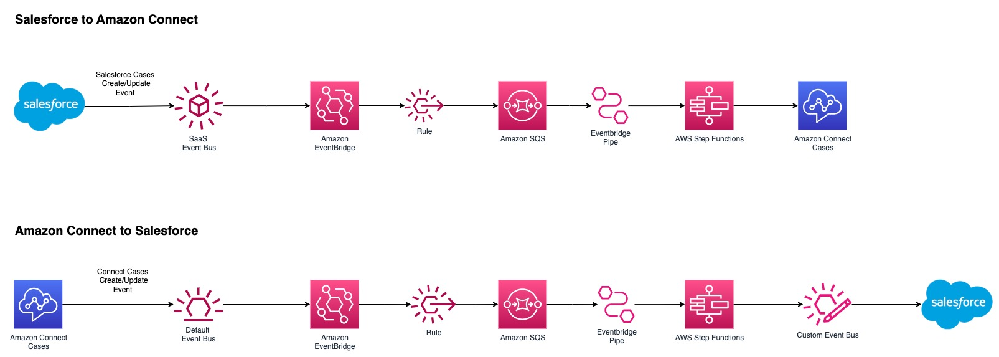
</p>

```
  +-------------------+                                  +-----------------------+
  |    Salesforce     |                                  |     Amazon Connect    |
  |   Service Cloud   |                                  |   Cases & Profiles    |
  +--------+----------+                                  +-----------+-----------+
           |                                                         ^
     Event | [Platform Event]                                        | [SDK / API]
     Relay |                                                         |
           v                                                         v
  +-------------------+       +-------------------+       +----------------------+
  |    EventBridge    | ----> |     Amazon SQS    | ----> |     Step Function    |
  | Partner Event Bus |       | (Salesforce Queue)| (Pipe)| (SF to Connect Sync) |
  +-------------------+       +-------------------+       +----------------------+

           ^                                                         |
           | [API Destination]                                       | [Event Stream]
           |                                                         v
  +-------------------+       +-------------------+       +----------------------+
  |    EventBridge    | <---- |     Step Function | <---- |     EventBridge      |
  | Custom Event Bus  |       | (Connect to SF)   | (Pipe)|   Default EventBus   |
  +-------------------+       +-------------------+       +----------------------+
```

### Salesforce to Connect Cases Workflow

Triggered when a Salesforce case is created or modified.

<p align="center">
  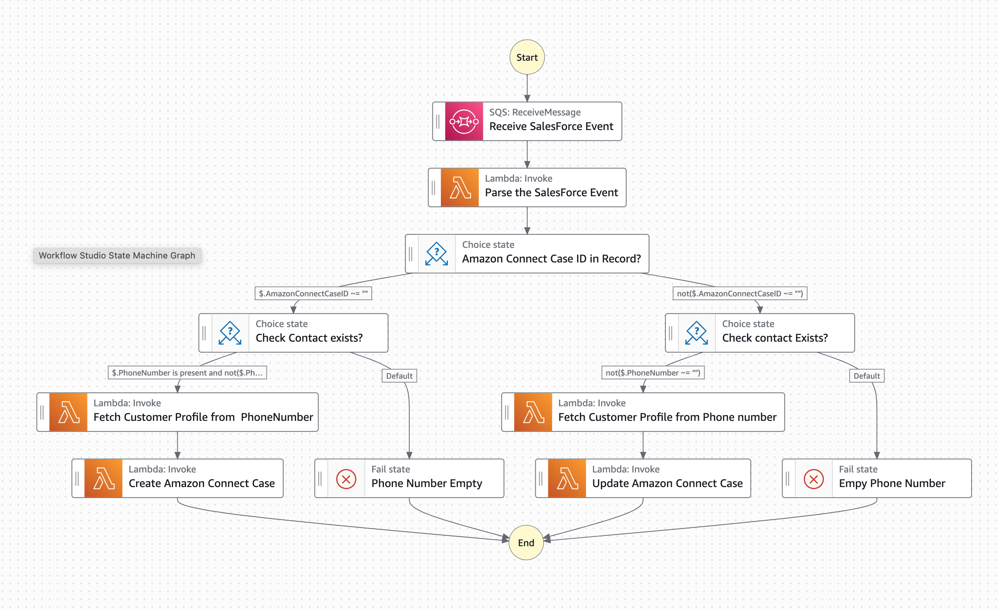
</p>

1. **Salesforce Flow** detects Case create/update and publishes a `CustomerSupport__e` platform event.
2. **Salesforce Event Relay** forwards the event to Amazon EventBridge Partner Event Bus.
3. **EventBridge Rule** routes the payload to `SalesforceToConnectQueue` (Amazon SQS).
4. **Amazon EventBridge Pipe** feeds the event into `SalesforceToConnectStateMachine`.
5. **State Machine Execution**:
   - `sfLambdaReadSQS`: Parses payload and extracts case identifiers.
   - Evaluates if `AmazonConnectCaseID` is present:
     - **If New Case**: Calls `sfLambdaCP` to match/create the Customer Profile, then invokes `sfLambdaConnectCreateCase` to create the case in Amazon Connect.
     - **If Existing Case**: Calls `sfLambdaConnectUpdateCase` to update case details and append internal comments.

### Connect Cases to Salesforce Workflow

Triggered when an agent creates or updates a case within Amazon Connect Agent Workspace.

<p align="center">
  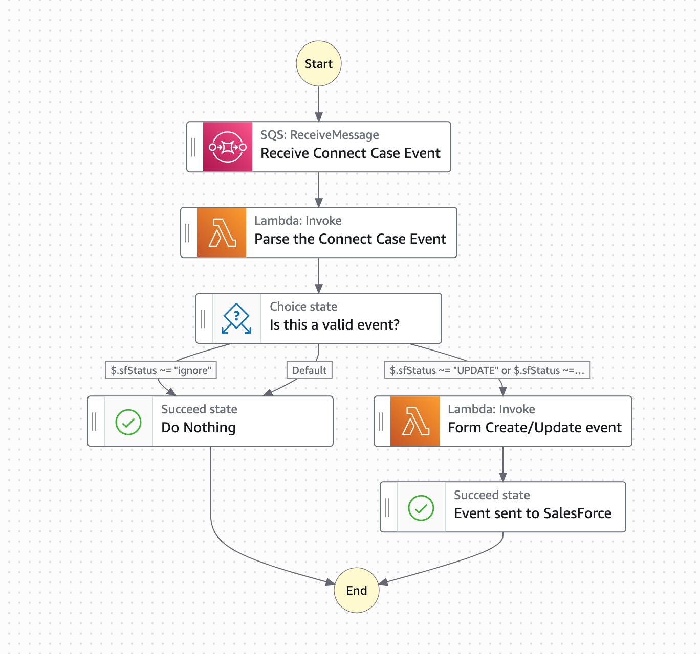
</p>

1. Amazon Connect Cases streams change events (`CASE.CREATED`, `CASE.UPDATED`, `RELATED_ITEM.CREATED`) to the default EventBridge bus.
2. An EventBridge Rule forwards eligible events to `ConnectToSalesforceQueue` (Amazon SQS).
3. **EventBridge Pipe** invokes `ConnectToSalesforceStateMachine`.
4. **State Machine Execution**:
   - `connectLambdaReadSQS`: Evaluates whether the operation originated from Salesforce. If performed by `salesforce`, it safely marks it as `IGNORE` to eliminate loops.
   - For valid events (`CREATE`, `UPDATE`, `COMMENT`), `connectLambdaCreateOrUpdateCase` formats the payload and emits it to `EventbridgeToSalesforceEventbus`.
5. **EventBridge Rule & API Destination** authorizes with Salesforce OAuth 2.0 and publishes to the `Connect_Case__e` platform event in Salesforce.
6. **Salesforce Inbound Flow** updates or creates the corresponding Salesforce record.

---

## Field Mapping Reference

| Salesforce Platform Event (`CustomerSupport__e` / `Connect_Case__e`) | Amazon Connect Cases Field | Description |
| :--- | :--- | :--- |
| `AmazonConnectCaseID__c` | `caseId` | Amazon Connect Cases unique identifier (UUID) |
| `CaseID__c` | Custom Field (`Salesforce CaseID`) | Salesforce Case record ID (18-character string) |
| `Subject__c` | `title` | Case summary / headline title |
| `Description__c` | `summary` | Detailed description of customer issue |
| `Phone_Number__c` | Profile `_phone` / `PhoneNumber` | Customer contact number used for profile linkage |
| `Comments__c` | Related Item (`Comment`) | Case comments / internal interaction notes |
| `sf_operation__c` | Operation identifier | `CREATE`, `UPDATE`, or `COMMENT` |
| `Status__c` | `status` | Case workflow status |

---

## Loop Prevention & Idempotency

A common challenge in bidirectional integrations is recursive infinite loops (System A updates System B, which emits an event updating System A, repeating indefinitely).

This architecture prevents loops at two checkpoints:

1. **Origin Tagging on Connect API Calls**:
   When writing to Amazon Connect Cases, the Lambda functions set:
   ```json
   "performedBy": { "customEntity": "salesforce" }
   ```
2. **Deterministic Event Inspection**:
   When reading from Connect event streams, `connectLambdaReadSQS` inspects `detail.performedBy`. If `customEntity == "salesforce"`, the update is flagged as `IGNORE` and the state machine completes without making calls back to Salesforce.
3. **Client Tokens**:
   All new case creations use an idempotency client token to prevent duplicate case creation during Step Function retries.

---

## Prerequisites

- AWS Account with Administrator privileges.
- [AWS CLI](https://aws.amazon.com/cli/) and [AWS SAM CLI](https://docs.aws.amazon.com/serverless-application-model/latest/developerguide/install-sam-cli.html) installed.
- [Amazon Connect Instance](https://aws.amazon.com/connect/) with **Cases** and **Customer Profiles** enabled.
- [Salesforce Developer Edition / Sandbox](https://developer.salesforce.com/free-trials) with Service Cloud.

---

## Step-by-Step Installation Guide

### 1. Salesforce Configuration

#### A. Create Custom Case Field
1. In Salesforce Setup, go to **Object Manager** &rarr; **Case** &rarr; **Fields & Relationships**.
2. Create a new custom field:
   - **Data Type**: `Text`
   - **Field Label**: `Amazon Connect CaseID`
   - **Length**: `255`
   - **Field Name**: `Amazon_Connect_CaseID` (`Amazon_Connect_CaseID__c`)

#### B. Configure Connected App / External Client App for OAuth
1. In Salesforce Setup, create an **External Client App** or **Connected App** with OAuth enabled.
2. Enable `Client Credentials Flow`.
3. Note your **Client ID**, **Client Secret**, and your OAuth Token URL (`https://<domain>.my.salesforce.com/services/oauth2/token`).

#### C. Create Platform Events
Create two Custom Platform Events in Salesforce (**Setup** &rarr; **Platform Events**):

**1. CustomerSupport (`CustomerSupport__e`)** (Outbound: Salesforce &rarr; AWS):
- `AmazonConnectCaseID__c` (Text, 255)
- `Case_Comments__c` (Text, 255)
- `CaseID__c` (Text, 255)
- `Description__c` (Text, 255)
- `Phone_Number__c` (Phone)
- `Subject__c` (Text, 255)

<p align="center">
  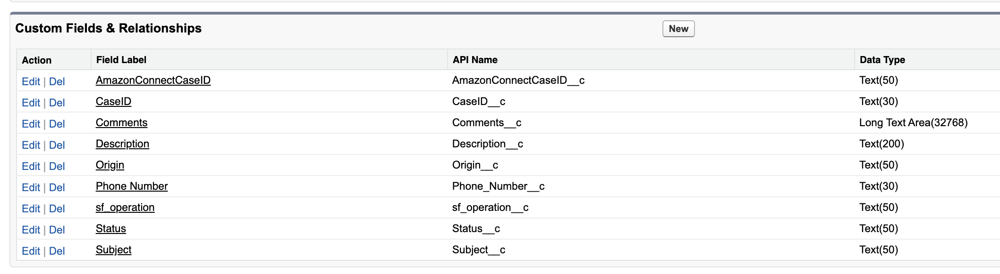
</p>

**2. Connect_Case (`Connect_Case__e`)** (Inbound: AWS &rarr; Salesforce):
- `AmazonConnectCaseID__c` (Text, 255)
- `CaseID__c` (Text, 255)
- `Comments__c` (Text, 255)
- `Description__c` (Text, 255)
- `Origin__c` (Text, 255)
- `Phone_Number__c` (Text, 255)
- `sf_operation__c` (Text, 255)
- `Status__c` (Text, 255)
- `Subject__c` (Text, 255)

<p align="center">
  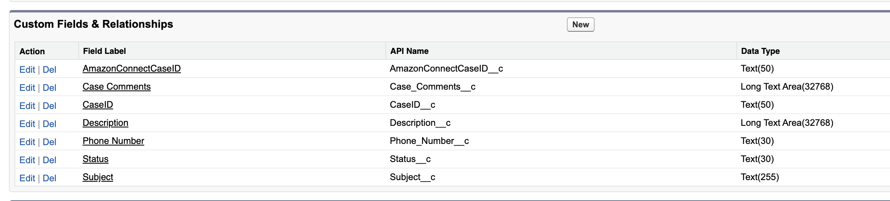
</p>

#### D. Create Salesforce Flows

* **Flow 1 (Outbound: Salesforce to Connect)**:
  Create a Record-Triggered Flow on the `Case` object (on creation and update). Add a `Create Records` element to publish a `CustomerSupport__e` Platform Event with the case fields.

  <p align="center">
    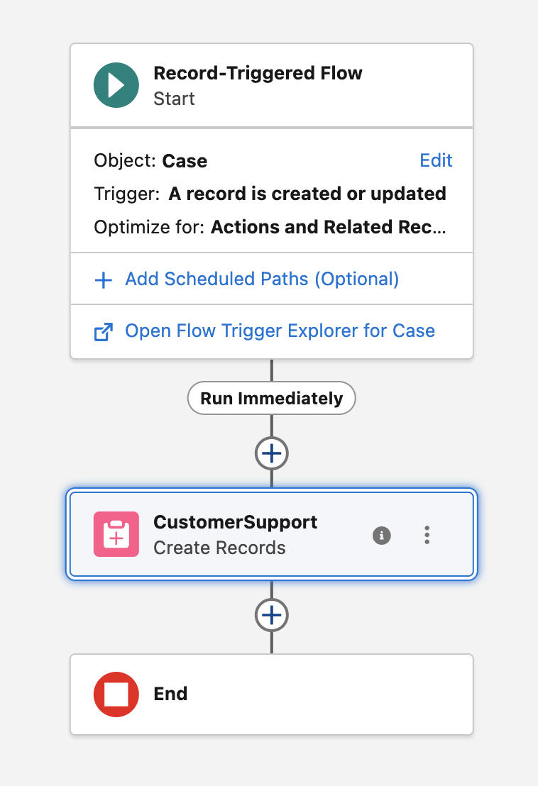
  </p>

* **Flow 2 (Inbound: Connect to Salesforce)**:
  Create a Platform Event-Triggered Flow subscribed to `Connect_Case__e`. Branch on `sf_operation__c`:
  - `create`: Query Contact by phone, create a new Case, and link Contact.
  - `update`: Update existing Case matching `CaseID__c` or `AmazonConnectCaseID__c`.
  - `comment`: Append to Case Comments.

  <p align="center">
    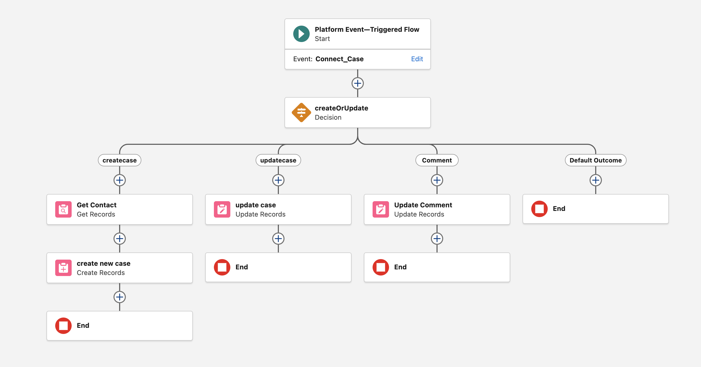
  </p>

---

### 2. Amazon Connect Cases Configuration

1. In the Amazon Connect Admin Console, navigate to **Cases**.
2. Create a custom case field named **Salesforce CaseID**. Note its Field ID (e.g. `b626885e-4f35-4094-b3b8-d0216e4d5cec`).
   <p align="center">
     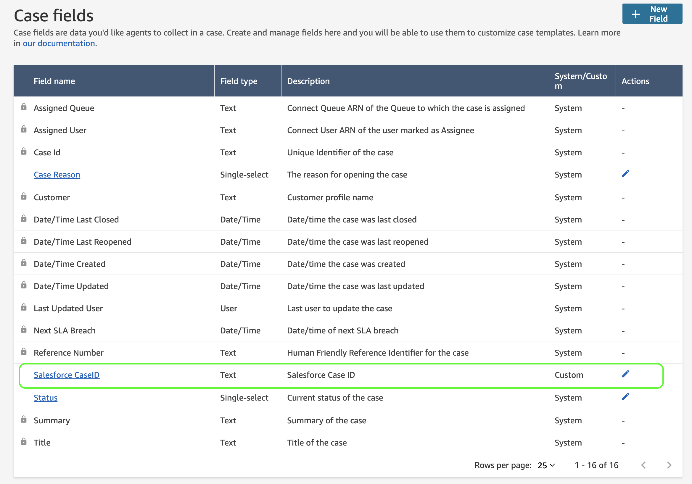
   </p>
3. Create a **Case Template** containing `Customer`, `Title`, `Summary`, and the `Salesforce CaseID` custom field.
   <p align="center">
     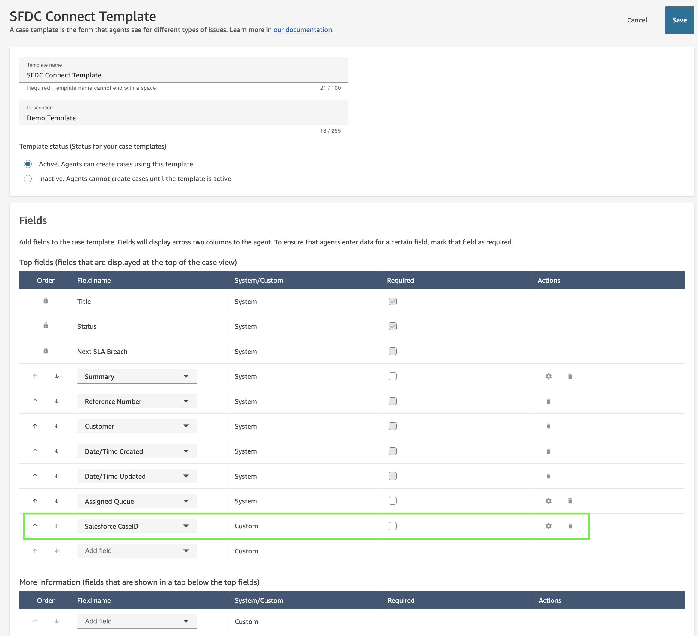
   </p>

---

### 3. Salesforce Event Relay Setup

Configure Salesforce Event Relay to stream `CustomerSupport__e` events to AWS EventBridge:
1. Create a **Named Credential** pointing to your AWS Region.
2. Create an **Event Relay Channel** and add `CustomerSupport__e` as a channel member.
3. Start the Event Relay. In AWS EventBridge, navigate to **Partner Event Sources** and associate the pending partner source with your AWS account. Copy the Partner Event Bus ARN.

---

### 4. Amazon Connect Cases Event Streaming

Enable event streaming for Amazon Connect Cases to publish change events to Amazon EventBridge:
```bash
aws connectcases put-case-event-configuration \
    --domain-id "<YOUR_CASE_DOMAIN_ID>" \
    --event-bridge includedData="{caseData={fields=[{id=title},{id=summary},{id=status},{id=<SALESFORCE_CASE_FIELD_ID>}]}}"
```

---

### 5. Deploying the AWS SAM Application

1. Clone this repository and navigate to the `serverless-artifact` directory:
   ```bash
   cd serverless-artifact
   ```
2. Build the serverless application:
   ```bash
   sam build
   ```
3. Deploy using guided parameters:
   ```bash
   sam deploy --guided
   ```

#### Deployment Parameter Reference

| Parameter | Description | Example / Format |
| :--- | :--- | :--- |
| `CPDomainName` | Amazon Connect Customer Profiles Domain Name | `my-connect-profile-domain` |
| `CaseDomainName` | Amazon Connect Cases Domain Name | `my-connect-cases-domain` |
| `TemplateName` | Name of the Cases Template | `DefaultTemplate` |
| `SalesforceOauthUrl` | Salesforce OAuth 2.0 token endpoint | `https://mydomain.my.salesforce.com/services/oauth2/token` |
| `SalesforceOauthClientId` | Salesforce Connected App Client ID | Stored in AWS Secrets Manager |
| `SalesforceOauthClientSecret` | Salesforce Connected App Client Secret | Stored in AWS Secrets Manager |
| `SalesforceCaseProcessorEndpointUrl` | Salesforce REST endpoint for `Connect_Case__e` | `https://mydomain.my.salesforce.com/services/data/v60.0/sobjects/Connect_Case__e` |
| `SalesforcePartnerEventBusArn` | ARN of the EventBridge Partner Event Bus | `arn:aws:events:us-east-1:123456789012:event-bus/aws.partner/...` |
| `SalesforcePartnerEventPattern` | Pattern matching partner events | `{"detail-type": ["CustomerSupport__e"]}` |
| `SalesforceCaseFieldID` | Field ID of `Salesforce CaseID` custom field | `b626885e-4f35-4094-b3b8-d0216e4d5cec` |
| `EventBridgeRateLimit` | API Destinations invocations per second limit | `10` |

---

## Verification & Testing

### Test 1: Connect Cases &rarr; Salesforce Case Creation
1. Open Amazon Connect Agent Workspace, select a customer, and click **Create Case**.
   <p align="center">
     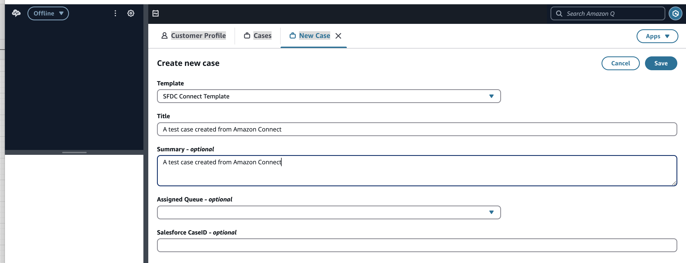
   </p>
2. Fill in Title and Summary and click **Create**.
3. Within seconds, refresh the case view in Agent Workspace to verify the `Salesforce CaseID` has been populated automatically:
   <p align="center">
     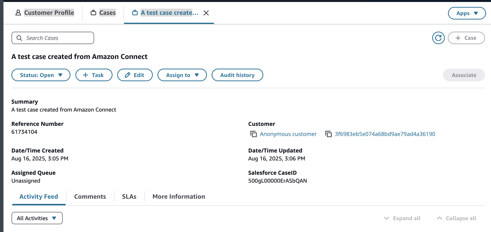
   </p>
4. Log into Salesforce and verify the new Case record exists with matching details and linked Contact:
   <p align="center">
     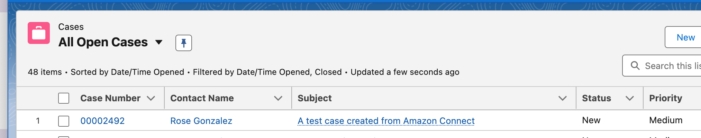
   </p>

### Test 2: Field Updates Synchronization
1. Edit the Case Summary in Amazon Connect Agent Workspace:
   <p align="center">
     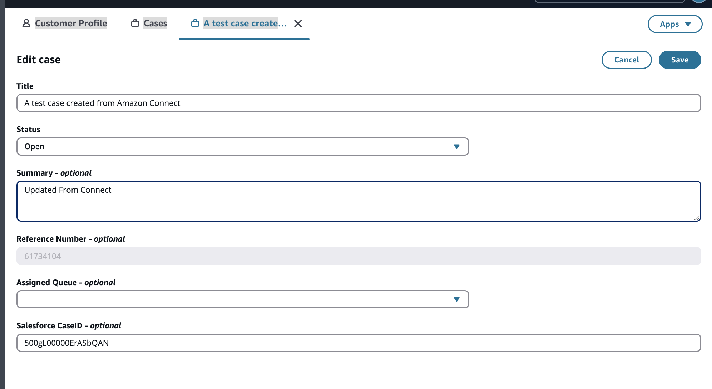
   </p>
2. Refresh Salesforce to verify the Description field reflects the updated text:
   <p align="center">
     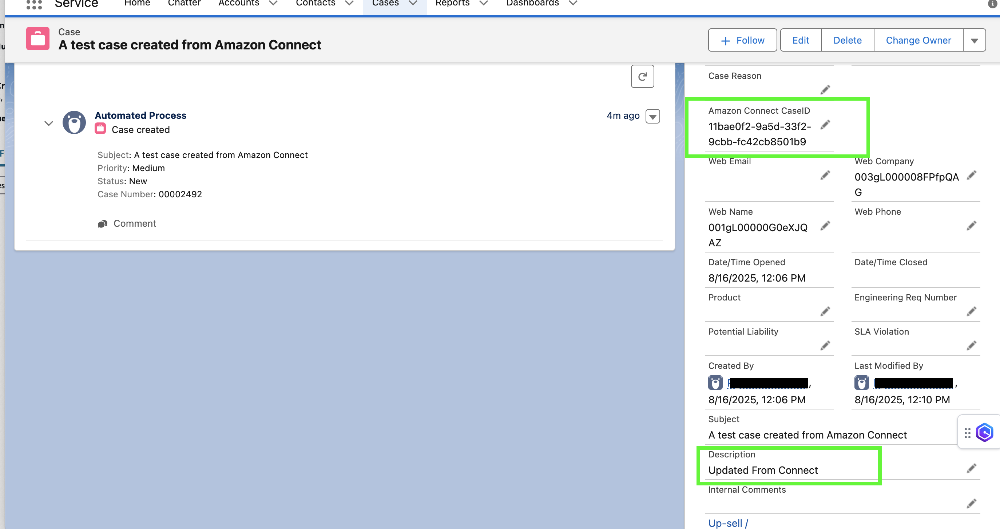
   </p>

### Test 3: Comment Synchronization
1. Add a Comment to the Connect Case:
   <p align="center">
     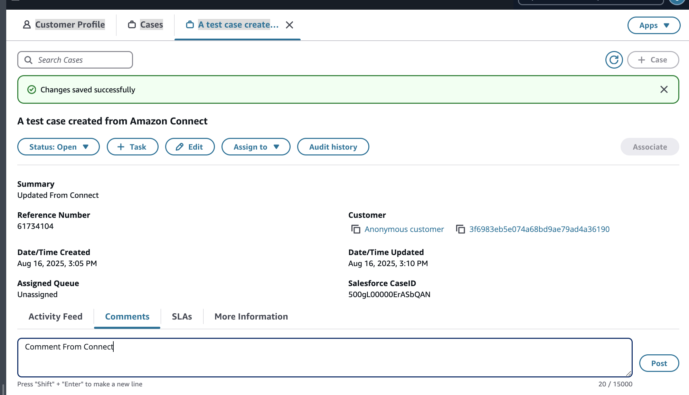
   </p>
2. In Salesforce, verify the comment appears in the Case Comments related list:
   <p align="center">
     
   </p>

---

## Repository Structure

```
.
├── .gitignore                                      # Root Git ignore configuration
├── LICENSE                                         # MIT License
├── README.md                                       # Documentation & Implementation Guide
├── CODE_OF_CONDUCT.md                              # Code of Conduct
├── CONTRIBUTING.md                                 # Contributing Guidelines
├── images/                                         # Architecture and validation screenshots
├── generated-diagrams/                             # Python Diagrams code and generated assets
└── serverless-artifact/                            # AWS SAM Project
    ├── template.yaml                               # CloudFormation SAM template
    ├── samconfig.toml                              # SAM CLI deployment parameters
    ├── connect-lambdas/                            # Amazon Connect to Salesforce Lambdas
    │   ├── create-case/
    │   │   └── connectLambdaCreateOrUpdateCase.py  # Emits formatted events to Salesforce
    │   └── read-sqs/
    │       └── connectLambdaReadSQS.py             # Parses Connect Cases events & prevents loops
    └── sf-lambdas/                                 # Salesforce to Amazon Connect Lambdas
        ├── create-case/
        │   └── sfLambdaConnectCreateCase.py        # Creates new cases in Connect Cases
        ├── find-cp/
        │   └── sfLambdaCP.py                       # Finds or creates Customer Profiles
        ├── read-sqs/
        │   └── sfLambdaReadSQS.py                  # Parses Salesforce platform events
        └── update-case/
            └── sfLambdaConnectUpdateCase.py        # Updates existing Connect cases & adds comments
```

---

## Monitoring & Troubleshooting

* **AWS Step Functions**: Navigate to the Step Functions console to inspect state transitions, inputs, outputs, and any retry executions for:
  - `SalesforceToConnectStateMachine`
  - `ConnectToSalesforceStateMachine`
* **CloudWatch Log Groups**: Detailed JSON logs with execution metrics are written to:
  - `/aws/lambda/SalesforceToConnectLambda-*`
  - `/aws/lambda/ConnectToSalesforceLambda-*`
* **Amazon SQS Queues**: Check queue metrics for `ApproximateNumberOfMessagesVisible` and `ApproximateAgeOfOldestMessage` on:
  - `SalesforceToConnectQueue`
  - `ConnectToSalesforceQueue`

---

## Cleanup

To decommission the integration and avoid ongoing charges:

1. Delete the deployed CloudFormation stack:
   ```bash
   sam delete --stack-name salesforce-connect-cases
   ```
2. In Salesforce, disable and remove the Event Relay and Named Credential.
3. Remove custom platform events and custom case fields in Salesforce if no longer needed.

---

## License

This project is licensed under the MIT License - see the [LICENSE](./LICENSE) file for details.
